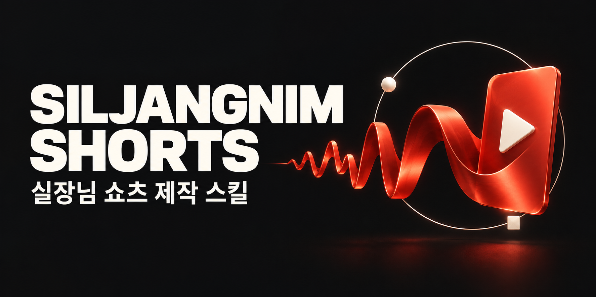

# 실장님 Shorts



**실장님 소개·설명 쇼츠를 직접 만들기 위해 쓰는 개인 제작 스킬입니다.**

[실장님](https://github.com/okdalto/siljangnim)의 실험과 기능을 짧은 영상으로 소개할 때 사용합니다. 에이전트와 대화하며 대본·음성·한영 자막·설명 모션·썸네일을 만들고, 결과를 보면서 고칩니다.

실제 쇼츠를 한 편씩 만들면서 제작 방식을 계속 다듬습니다. 반복해서 필요한 기준과 작업은 스킬과 보조 도구에 반영하고, 특정 영상의 연출과 수정은 그 영상의 소스에 남깁니다. [SKILL.md](SKILL.md)는 그 과정에서 쌓이는 제작 규약입니다.

실험 영상은 [실험에서 쇼츠까지](references/experiment-to-short.md)의 흐름으로 만듭니다. 실제 계산 기록을 보존하고, 발화에 맞춰 과정을 보여 준 뒤, 별도 썸네일과 로컬 미리보기까지 검수합니다. [에피소드 검수 양식](templates/experiment-review.md)은 자동 검사와 직접 보고 들은 검수를 구분합니다.

[이 스킬로 만든 홍보 영상·썸네일](https://github.com/okdalto/siljangnim-shorts/releases/tag/v1.0.0) · [홍보 예제 설명](docs/PROMO.md)

## 설치와 사용

Codex의 스킬 폴더에 설치합니다.

```sh
git clone https://github.com/okdalto/siljangnim-shorts.git ~/.codex/skills/siljangnim-shorts
```

이미 받은 저장소는 심볼릭 링크로 연결해도 됩니다. 다른 에이전트에서는 해당 호스트의 스킬 설치 방식을 따르거나 `SKILL.md`를 읽도록 지정합니다.

> “실장님 Shorts 스킬로 쇼츠 과잉을 비꼬는 홍보 영상을 만들어 줘. 썸네일도 같이.”
>
> “첫 장면의 카드가 옆에서 밀려오게 바꿔 줘. 음성은 유지하고 위아래 여백은 대칭으로.”

에이전트가 기획과 수정 판단을 맡습니다. 별도 편집 앱이나 MCP 연결은 필요하지 않습니다. 제작에는 코드 실행과 이미지·영상 확인이 가능한 에이전트 환경이 필요합니다.

## 제작 환경

처음이라면 에이전트에게 이렇게 말하세요.

> “실장님 Shorts 처음 쓰는데 환경 점검부터 API 키 설정, Manim 설치까지 해 줘. 필요한 생성 서비스도 추천해 줘.”

에이전트가 [초기 설정 안내](references/onboarding.md)에 따라 OS·도구를 점검하고 필요한 라이브러리를 설치한 뒤 실제 렌더를 확인합니다. `scripts/doctor.py`는 환경을 점검하고, `scripts/setup.sh`는 음성 정렬·Remotion·Manim 환경을 설치합니다. API 키는 채팅 대신 숨김 터미널 입력으로 저장할 수 있습니다.

기본 음성 추천은 Comfy Router의 ElevenLabs George이며, 이미지 생성은 에이전트의 기존 도구 또는 Higgsfield 같은 유료 API를 추천합니다. 특정 서비스는 필수가 아닙니다. 원하는 서비스를 말하면 에이전트가 현재 공식 문서에서 연동 방법을 찾아 해당 작업에 연결합니다. 무료·로컬 솔루션도 선택할 수 있습니다. 외부 API는 이용 요금과 별도 계정 설정이 필요할 수 있습니다.

기본 `./shorts speech`는 Comfy 경로입니다. 다른 서비스는 키 저장만으로 연결되지 않으며, 에이전트가 필요한 도구 연결 또는 작업별 어댑터를 준비합니다. [제작 명령·저장 경로](references/production-tools.md)

## 제작 기준과 전달 파일

1080×1920·60fps, 위아래 270px 대칭 여백, 영어 음성에 맞춘 한영 자막, 도형 변화로 설명하는 모션과 원본 실장님 로고 엔딩을 기본으로 합니다. 썸네일은 별도로 만듭니다.

승인된 영상 한 편의 Drive 전달 파일은 세 개입니다.

| 파일 | 내용 |
|---|---|
| `<주제>_final.mp4` | 한영 자막이 포함된 최종 영상 |
| `<주제>_thumbnail.png` | 최종 썸네일 |
| `<주제>_caption_KO_EN.txt` | 한국어 본문 → 영어 본문 → 공통 해시태그 최대 5개 |

[전달·검증 절차](docs/DRIVE_DELIVERY.md)

## 저장소 안내

| 경로 | 역할 |
|---|---|
| [SKILL.md](SKILL.md) | 에이전트가 읽는 공통 제작·수정·검수 규약 |
| [references/](references/) | 필요할 때 읽는 도구 사용법과 디자인 계약 |
| `shorts`, `shorts_app/`, `scripts/` | 제작 보조 명령과 Python 구현 |
| `motion/`, `remotion/`, `assets/` | 모션·합성 환경과 공용 브랜드 자산 |
| [examples/revenge-morph/](examples/revenge-morph/) | 홍보 영상의 구체적인 소스·편집 도구 |
| [docs/ARCHITECTURE.md](docs/ARCHITECTURE.md) | 제작 흐름과 코드 구성 |

작업물은 `agent-projects/`, 캐시는 `.cache/`에 저장되며 Git에서 제외됩니다. 코드 실행 도구이므로 에이전트가 작성·검토한 소스만 실행합니다.

## 개발과 출처

[검증 방법](docs/VERIFICATION.md). 내부 뷰어가 없는 환경에서는 `./shorts view`로 읽기 전용 결과 화면을 엽니다.

GPL-3.0-or-later. [실장님](https://github.com/okdalto/siljangnim)의 브랜드 자산과 기존 쇼츠 제작 코드를 재사용합니다. [출처·라이선스](THIRD_PARTY_NOTICES.md). Remotion과 외부 음성 서비스에는 각 제공자의 조건이 적용됩니다.
